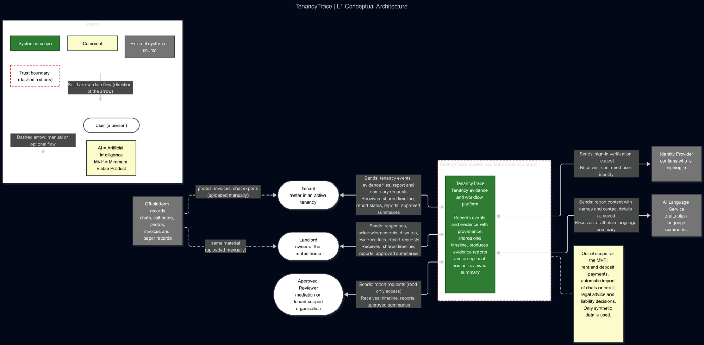

# L1 — Conceptual Architecture

**Original source:** user-supplied diagram image; Mermaid source was not provided. Preserve original rather than reconstructing it as purported exact source.

## Reading guide (editorial, not original diagram text)

- System: TenancyTrace tenancy evidence and workflow platform.
- Actors: tenant, landlord, approved reviewer.
- External systems: Microsoft Entra identity provider and AI language service; off-platform evidence uploaded manually.
- Tenant and landlord submit tenancy events and evidence; reviewer requests read-only reports.
- Excluded from MVP: payments, automatic import of email/chats, legal advice, liability decisions. Synthetic data only.
