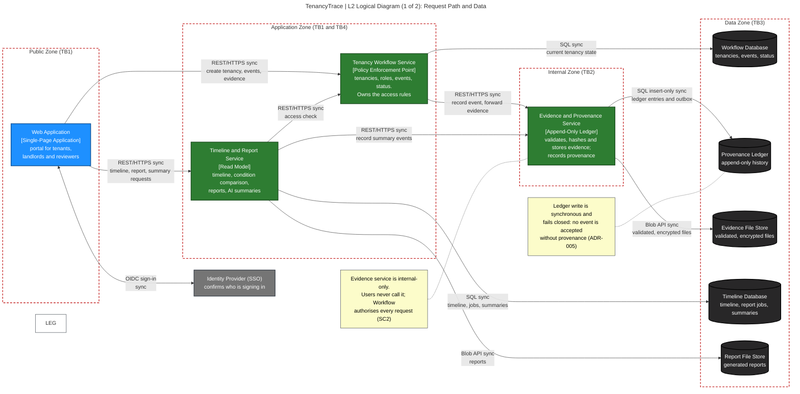

# L2 Logical Diagram (1 of 2): Request Path and Data

> Original Mermaid source preserved, including an unresolved `style LEG` reference. Do not silently fix source; resolve via a separate reviewed change.
