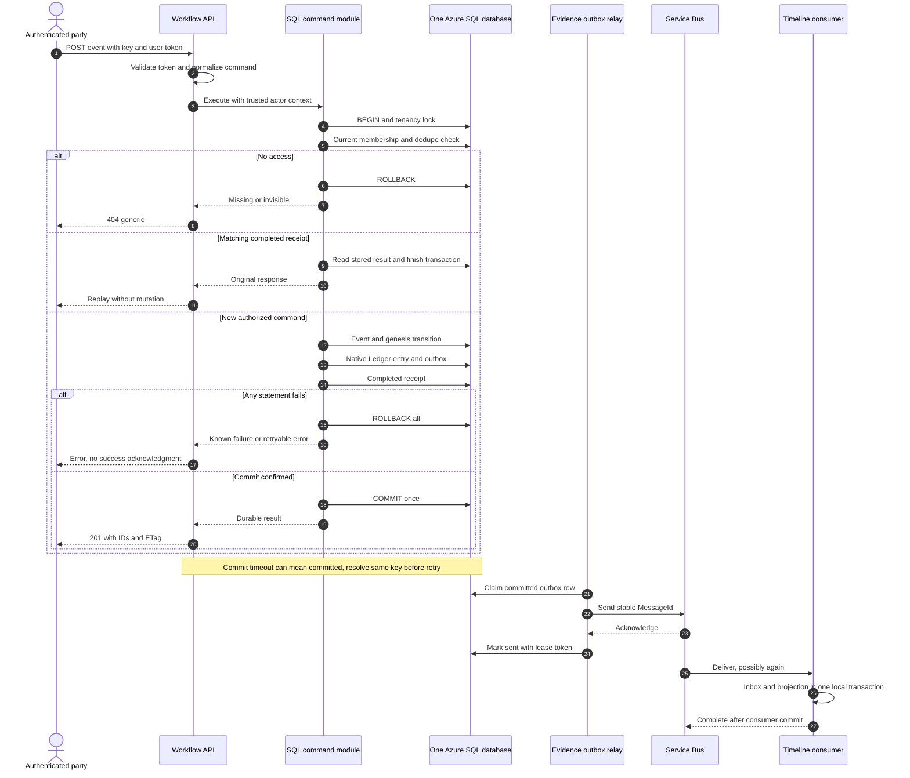

# Proposed acceptance protocol and schema ownership

**Conditional on approval of [P-006](proposed-adr-amendment.md).** The original
ADR-005/Flow 1 two-commit protocol is not silently redefined as already atomic.

## Ownership and least privilege

| Boundary | Design-time owner | Runtime permissions |
| --- | --- | --- |
| workflow schema, aggregate rules and command entry modules | Workflow | Workflow identity executes allowlisted command/read modules; no direct aggregate DML |
| evidence native Ledger, payload formats, outbox and append modules | Evidence & Provenance | Evidence identity executes scoped append/read/verify/relay modules; no Workflow table DML or generic event-acceptance append |
| Cross-schema acceptance command | Workflow orchestration, jointly reviewed with Evidence | Workflow enters reviewed module; narrowly signed/permissioned database modules append validated provenance/outbox inside the caller's SAME SQL transaction |
| timeline read model, inbox, job state/job outbox | Timeline & Reports | Own modules and schema only; no Workflow/ledger mutation |
| Schema migrations, grants and module signing | Deployment identity under review | No application DDL or db_owner; keep signing rights away from app identities |
| Ledger digests | Independently protected storage/operator boundary | Export write permissions separate from application identities; application cannot overwrite/delete retained digest evidence |

Logical ownership does not require a network call for every operation. Evidence
owns append semantics and validation, but the Workflow SQL command shares the
physical database transaction. Use explicit module signing/least-privilege grants,
not database-wide ownership chaining, dynamic SQL or caller-controlled table names.
Nested append modules must not open independent connections, commit early, swallow
errors or accept arbitrary event acceptance records. Publish an allowlist of record
types per caller: only acceptance modules can emit EventCreated/StatusChanged;
Timeline cannot forge them via an Evidence.Write role. Keep non-event attachment,
report and summary appends separate. Test grants with each actual service identity.

Evidence's HTTP runtime being down does not itself prevent a metadata SQL acceptance
if its reviewed SQL append module is available. That is an explicit ADR-005 change.
Failure of the Ledger insert or any atomic operation DOES prevent acceptance. A
synthetic health probe against Evidence HTTP is not the transaction's durability test.

## Invariants and durable result

For every committed event version v: current/version history, one native Ledger
entry and its outbox event, and one completed command receipt are committed together.
No success response is sent before SQL confirms commit. All accepted transitions,
consents and membership changes have the same provenance rule. Uncommitted data
is never published or queried using NOLOCK/read-uncommitted.

The invariant assumes durable Azure SQL transaction semantics, correct implementation,
restricted writers and successful recovery. It does not claim availability or
survival of every disaster/geo-failover RPO, nor immunity to a privileged attacker.
Native Ledger detects tampering when checked against independently preserved digests;
application SHA-256 payload hashes do not replace native Ledger verification.

## One command, one connection, one transaction

1. HTTP host authenticates and checks request bounds. Resolve tenancy from route;
   never let body data change it. Build normalized command and idempotency scope.
2. Execute the command module with a single SQL connection and transaction, error
   abort enabled, short command timeout, and durable commit (no delayed durability).
   Use SERIALIZABLE/explicit range locks for dedupe insertion. For MVP serialize
   per tenancy with an exclusive transaction-owned application lock and check lock
   acquisition result. All event, consent, membership and expiry/revocation mutation
   modules obey this lock. Locking is a reviewed database protocol, not an in-memory
   mutex or distributed lock held across HTTP. Creation locks the creator's dedupe
   scope because no tenancy exists yet. Order: tenancy lock, dedupe key range, then
   event row; no command takes these in reverse. Bound contention and retry deadlocks.
3. Under that lock load current access/lifecycle using server time. For tenancy
   creation, look up the creator-scoped receipt first to identify a prior created
   tenancy, then reauthorize that tenancy before revealing the replay; otherwise
   bootstrap only a new Draft tenancy and its creator membership in this transaction. Enforce tenancy
   membership and operation-level role capability (not current-state edge guards
   for an already completed receipt). Locking orders revocation before or after
   acceptance: after a revocation commits, a new command cannot use its old grant.
   If expiry passes before the command's authorization timestamp it is denied;
   the short transaction defines that timestamp as the authorization linearization point.
4. Look up idempotency unique key. If found and request hash matches, return stored
   response after current visibility/action authorization, without applying a new
   mutation or requiring the old ETag still match. If hash differs, 409 and no effects.
   Serialize absent-key insertion via the unique range; concurrent same-key callers
   wait for commit/rollback. No independently committed Processing reservation.
5. For a new command validate If-Match against current rowversion and domain guards.
   Generate CommandId, EntryId, EventId/TransitionId and MessageId. For create, allocate
   the next version (1 for genesis). Insert the immutable event content/history or
   new transition; update only current status/version projection. Build authoritative
   provenance from locked state, authenticated actor, source and server timestamp.
6. Evidence-owned append module inserts into the native append-only Ledger and inserts
   outbox row in the same transaction. Bind every link to same TenancyId, subject,
   version and CommandId. Validate affected-row counts; a failure aborts all changes.
7. Insert/finalize completed idempotency receipt containing response body, status,
   Location, ETag and authoritative IDs. COMMIT once. Only now return stored success.
   Membership and tenancy creation use the same protocol, including bootstrap membership.
   No file upload, queue send, AI request, HTTP access callback or digest export is
   awaited inside this transaction.
8. Retry transient SQL errors up to three retries after the initial attempt, bounded
   by the request deadline and using the SAME key/command fingerprint. This retry-count
   interpretation is proposed because originals say “three times” without total attempts.
   Retry the entire module, never just its last insert. On uncertain commit first
   resolve the receipt using the primary database and same key; never create a new key.

## Request identity and canonical evidence

Unique scope = validated principal directory/object + versioned operation + resource
scope + SHA-256 of Idempotency-Key. ResourceScope is route tenancy/event/membership ID;
for tenancy creation it is `tenancies:create` (not a newly generated tenancy ID).
Key is case-sensitive, 16–128 ASCII characters with >=128 bits random entropy; never
log it. RequestHash includes API version, method, normalized route, supplied If-Match
and canonical semantic body; whitespace/object-property ordering do not change it.

Canonicalization v1 uses a documented fixed-property typed JSON serializer, UTF-8,
UTC ISO-8601 time format and explicit null handling; reject unknown fields/duplicate
JSON keys, preserve description text without trimming/Unicode rewriting. Publish
cross-runtime fixtures before implementation; do not hash raw arbitrary JSON and
assume semantic identity. Canonical provenance envelope additionally binds tenancy,
subject/version, actor, server timestamp, source and old/new state. Store the exact
canonical bytes and schema version with the digest. User OccurredAt is an assertion,
not the server commit timestamp. Attachment byte hashes are separately computed at
validated intake under ADR-002/004; they are not inferred from event text.

Store complete successful receipts initially for tenancy lifetime; do not expire a
key and allow a duplicate write. A future archive may compress responses only if
it preserves permanent dedupe scope/hash and replay result. Validation/authorization
failures roll back/no durable success receipt; retries are reevaluated. If the SQL
service cannot resolve a commit, return 503 `outcome_unknown`, not “not accepted.”
A known rollback uses 503 `write_not_committed`. Neither is success; retry same key.

## Outbox and projection recovery

Evidence relay claims pending rows in a short transaction with lease token/expiry,
sends AFTER commit to tenancy-events with stable MessageId and tenancy/event/version
in a versioned envelope, then marks Sent only after broker acknowledgment. Crash
after send yields a duplicate, never a new message identity. Expired claims are
reclaimable; attempts/backoff are persisted. Repeated relay failure alerts and retains
pending rows; no TTL drops committed events. A lease is not exactly-once delivery.

Timeline processes one message by inserting InboxReceipt and updating its projection
atomically, then completes the broker delivery. Duplicate InboxReceipt means no
second effect. Track version per event; for gaps defer/retry or rebuild from authorized
provenance, not silently skip history. Service Bus duplicate detection is optional
optimization, not correctness. Broker max delivery/dead-letter handling follows
ADR-003; replay preserves original MessageId and is audited. A pending relay does
not invalidate accepted provenance; reads may show projection lag explicitly.
Report/summary job outbox rows belong with their Timeline job transaction; their
completion/audit protocol remains outside this metadata acceptance design.

## Event acceptance sequence

## Attachments and integrity boundary

Event creation here accepts metadata only; attachment upload is a separate command.
Never acknowledge evidence attachment linking before its own validated blob reference,
Ledger entry/outbox and receipt protocol is complete. Blob staging, cleanup after
crashes, denial/rejection audit and verified read gating still require design; no SQL
transaction spans Blob/HTTP. Do not call unvalidated staging “accepted evidence.”
Native digest export and verification remain required before reports, on demand and
nightly as ADR-002 states. Define independent permissions, immutable retention,
checkpoint freshness alarms and restore tests before claiming tamper detection works.
