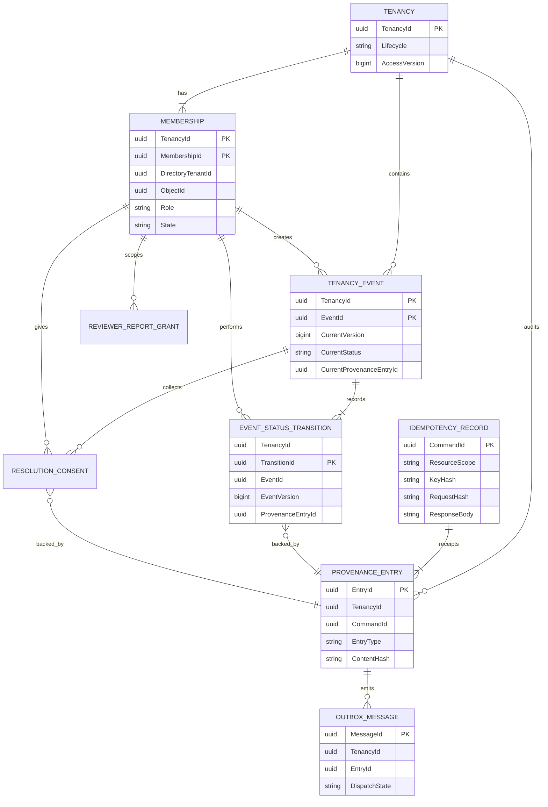

# Proposed domain entities

All tenancy-owned records carry `TenancyId`; principal identity is the validated
Entra `(DirectoryTenantId, ObjectId)` pair, never an email or a client-supplied role.
IDs are server-created UUIDs, SQL `uniqueidentifier`; UTC instants use `datetime2(7)`
with UTC semantics; digests are `binary(32)` SHA-256. `rowversion` is concurrency
metadata, not a timestamp, event sequence, or Ledger proof. No hard deletes in MVP.

## Entity definitions

| Entity and owner | Proposed fields | Rules and indexes |
| --- | --- | --- |
| `workflow.Tenancy` | TenancyId PK; SyntheticPropertyLabel; StartsOn; EndsOn nullable; Lifecycle Draft/Active/Closed; CreatedByDirectoryId/ObjectId; CreatedAtUtc; AccessVersion bigint; RowVersion | Start <= end if present. Creator membership is inserted atomically. Activation requires opposite-party membership. AccessVersion increments on every access-affecting change. |
| `workflow.Membership` | TenancyId; MembershipId; DirectoryTenantId; ObjectId; Role Tenant/Landlord/ApprovedReviewer; State Invited/PendingApproval/Active/Revoked/Expired; InvitedByMembershipId; InviteExpiresAtUtc; AcceptedAtUtc; TenantApprovalMembershipId; LandlordApprovalMembershipId; ApprovedReportIds via scoped grant rows; GrantExpiresAtUtc; CreatedAtUtc; RevokedAtUtc; RowVersion | PK (TenancyId, MembershipId); unique active principal per tenancy. Filtered unique indexes enforce one active Tenant and Landlord; reviewer cannot simultaneously be a party. Target identity immutable. Membership is not physical property ownership. |
| `workflow.TenancyEvent` | TenancyId; EventId; CreatorMembershipId; CreatorRoleAtCreation; EventType; Description; OccurredAtUtc (user assertion); RecordedAtUtc (server); Source UserSubmitted; PayloadSchemaVersion; PayloadHash; CurrentStatus; CurrentVersion bigint; CurrentProvenanceEntryId; RowVersion; SupersedesEventId nullable | PK (TenancyId, EventId). Content/creator immutable after creation; corrections are new events. Version starts at 1 and advances for each status change. Only current projection fields mutate. Supersedes must reference same tenancy and confers no delete authority. |
| `workflow.EventStatusTransition` | TenancyId; EventId; TransitionId; EventVersion; FromStatus nullable; ToStatus; Action; ActorMembershipId; ActorRoleAtAction; Reason nullable; ResolutionHash nullable; RecordedAtUtc; ProvenanceEntryId; CommandId | PK (TenancyId, TransitionId); unique (TenancyId, EventId, EventVersion). Creation includes a null-to-Unverified genesis transition at version 1. Insert-only through command module; subsequent edges follow guard table. Historical roles survive revocation. |
| `evidence.ProvenanceEntry` | TenancyId; EntryId; CommandId; SubjectType; SubjectId; EventId nullable; EventVersion nullable; EntryType; ActorDirectoryId/ObjectId; ActorMembershipId nullable; CallerServiceId; RecordedAtUtc; Source; Status nullable; PayloadSchemaVersion; CanonicalPayload; ContentHash; CorrelationId | Native Azure SQL append-only Ledger table. Unique EntryId; unique (CommandId, EntryType, SubjectId) for logical append identity. Never update/delete. Each accepted event version has one authoritative entry. SQL-generated Ledger transaction/sequence metadata is separate from EventVersion/EntryId. |
| `workflow.IdempotencyRecord` | CommandId PK; DirectoryTenantId/ObjectId; Operation; ResourceScope; KeyHash; RequestHash; RequestSchemaVersion; TenancyId nullable during create; ResultResourceId; ProvenanceEntryId; HttpStatus; ResponseBody; Location; ETag; CompletedAtUtc | Unique (DirectoryTenantId, ObjectId, Operation, ResourceScope, KeyHash). A committed row is Completed only, in same transaction as effects. Uncommitted reservation may exist inside that transaction; no persisted Processing row or expiring lease can authorize a second execution. |
| `evidence.OutboxMessage` | MessageId PK; TenancyId; EntryId; CommandId; AggregateId; AggregateVersion nullable; EventType; SchemaVersion; ImmutablePayload; CreatedAtUtc; Destination; DispatchState Pending/InFlight/Sent; LeaseToken nullable; LeaseUntilUtc nullable; Attempts; NextAttemptUtc; SentAtUtc nullable; LastErrorCode | Unique (EntryId, EventType, Destination). Ledger entry and initial row commit together. Envelope immutable; only dispatch fields mutable. Claim/complete by guarded procedures. Stable MessageId survives all retransmissions. |

The seven entities are not sufficient to model all consent/scoping safely. Supporting
proposals: `workflow.ResolutionConsent` (TenancyId, EventId, ResolutionHash, EventVersion,
ActorMembershipId, CommandId, ProvenanceEntryId, ConsentedAtUtc), unique per event
version/hash/party; `workflow.ReviewerReportGrant` (TenancyId, MembershipId, ReportId),
with expiry/approval inherited from membership; and `timeline.InboxReceipt`
(ConsumerName, MessageId, TenancyId, ProcessedAtUtc), unique per consumer/message.
These are documentation designs, not additional implemented entities.

## Lifecycle and guarded event edges

Creation yields Unverified. No assertion is automatically “verified” by durable storage.
Only active Tenant/Landlord memberships on an Active tenancy may write events. “Counterparty”
means the currently active party in the opposite role to CreatorRoleAtCreation,
not any user other than the author. Historical events whose creator role cannot
be mapped safely after membership succession are blocked pending a separate policy.

| Current -> next | Action and proposed guard |
| --- | --- |
| none -> Unverified | CreateEvent, either party |
| Unverified -> Acknowledged | Acknowledge, counterparty only |
| Unverified -> Disputed | Dispute, counterparty only; nonempty reason |
| Disputed -> Acknowledged | WithdrawDispute, membership that raised the active dispute only |
| Disputed -> Resolved | Resolve, both parties consent to identical resolution hash against the current event version |
| Acknowledged -> Resolved | Resolve, same two-party rule proposed to fill the missing original guard |
| Resolved -> none | Terminal; new evidence or correction is a new event, not mutation of history |

Consent is not a new event status or a same-status transition. First consent appends
its own provenance/outbox and receipt; current event version stays unchanged. The
second matching consent creates the status transition in that same transaction.
A status change, revoked party, or changed resolution text invalidates prior consents
for future use; keep records, never delete history. Serialize consent/status commands
under the event lock. The resolution hash covers normalized text and both event ID
and expected version, preventing consent substitution across events.

Tenancy/membership create, activate, consent, revoke and expire actions also use
provenance/outbox plus a receipt atomically. Expiry is checked by server time even if
an expiry projection job is late. State is a projection; Ledger records are history.

## Relationships (logical, not executable DDL)

All ordinary child FKs include TenancyId, including actor, supersession, consent and
grant references; membership pointers cannot connect two tenancies. Relationships
to/from Ledger are **logical references**, not a claim that Azure Ledger supports
every drawn FK/constraint. Avoid circular FKs. Validate Ledger-supported index/FK
capabilities on the target engine before writing migrations. Command procedures
validate logical references transactionally; integrity checks detect drift. A UUID
or foreign key alone does not implement tenancy authorization.
